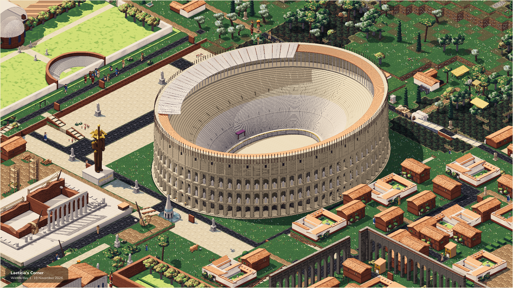
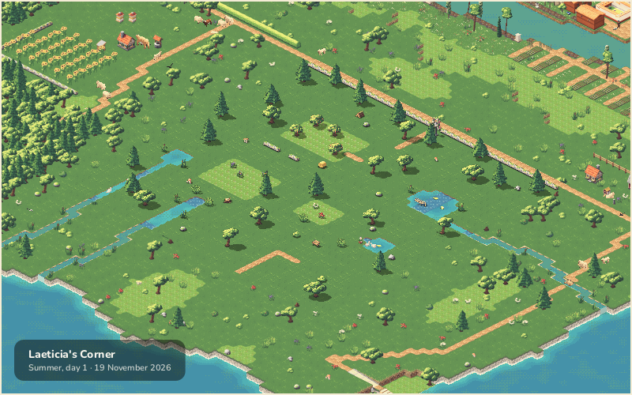
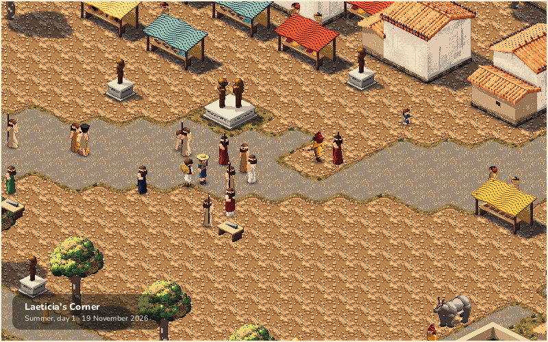

# Laeticia's Corner



A cosy isometric pixel-art world you decorate at your own pace. You are given a small corner of
land at the edge of an old world: paint the ground, plant trees and flowers, place a cottage and
garden pieces. There is no score, no money, no timer and no way to fail.

What you build decides who comes to stay. Ducks find a pond and swim in a line, a cat moves into
the cottage and naps on the bench, hens peck between the vegetable beds, fireflies come out at night.
Laeticia, who lives in the corner, waters the beds, reads on a bench, warms herself at the fire,
shelters from the rain and now and then makes a small wish; granting it unlocks new pieces, and as her
sketchbook fills, the wild land around the corner opens up.

Beyond the corner the world goes on: roads and rivers, villages and harbours, and three ancient
cities, Rome, Athens and Pārsa, each busy with its own people at work, markets, festivals and
traffic on the roads and the sea. The sun moves, shadows turn, weather crosses the map and the
four seasons come to every region in their own way. Every sprite, sound and piece of music is
made by the project's own generators.

**State: in development.** It runs and is playable, and it changes every week. Saves are kept
compatible, but expect rough edges.

## Screenshots





Both were made headless by [`docs/images/readme.lcs`](docs/images/readme.lcs); the postcard at
the top was taken in the game.

## Requirements

- Linux (the only platform built and tested so far)
- A C++23 compiler: GCC (default presets) or Clang (`clang-*` presets)
- CMake 3.28 or newer, Ninja
- SDL 3.4 or newer and nlohmann_json 3.11 or newer, with development files
- For regenerating assets only: Python 3 with `venv`, and `ffmpeg` for the audio validator

## Build and run

```sh
cmake --preset release
cmake --build --preset release -j3
build/release/laeticias-corner
```

The last line opens the game in a window. Tests and a headless run (no window, no sound, a
scratch save folder):

```sh
ctest --preset release -R unit
ctest --preset release
SDL_VIDEODRIVER=dummy SDL_AUDIODRIVER=dummy build/release/laeticias-corner \
    --headless --size 1280x800 --save-dir out/try --frames 300
```

More in [Getting started](docs/contributing/getting-started.md) and
[Testing](docs/contributing/testing.md).

## Controls

| Action | Keys and mouse |
|---|---|
| Look around | drag, or WASD / arrow keys |
| Zoom | mouse wheel, `+` / `-` (zooming far out opens the map) |
| Back to the corner | `Home` |
| Build drawer | `B`; pick a piece, click to place, drag for small pieces |
| Rotate or change the look of a piece | `R` |
| Move, remove | `V`, `X` |
| Copy a piece (eyedropper) | `Alt`+click, middle click, or `I` then click |
| Straight line or rectangle | hold `Shift` while dragging; brush size `[` `]` |
| Undo, redo | `Ctrl+Z`, `Ctrl+Shift+Z` |
| Grid, all footprints | `G`, hold `Tab` |
| Map and travel | `M` |
| Sketchbook | `J` |
| Clock, weather | `C`, `N` |
| Postcard mode | `P` (then `F` frame, `T` caption, `H` hide the bar, `Space` take) |
| Follow a figure | `F` on its card |
| Mute | `Ctrl+M` |
| Fullscreen | `F11` |
| Profiler | `F3` |
| Pause menu | `Esc` |

## Saves

The game saves on its own and reopens where you left off. Saves, settings and postcards go to
`--save-dir DIR` if given, else `$LAETICIA_SAVE_DIR`, else SDL's preference folder (on Linux
`~/.local/share/Laeticia/laeticias-corner/`). Postcards go to a `postcards/` folder beside a
named save folder, otherwise to your Pictures folder.

## Regenerating the assets

All art, audio and world data are generated by deterministic Python tools and committed. Each
tool makes its own virtual environment with pinned packages on first use:

```sh
tools/artgen/build.sh                 # the home atlas
tools/artgen/build.sh --set parsa     # one set's pages and geometry
tools/audiogen/generate.sh            # all music, ambience and effects
tools/worldgen/build.sh parsa         # compile and validate one world layer
tools/worldgen/build.sh --check       # validate the composed world
```

Generated files are never edited by hand: change the generator and regenerate. The READMEs in
each tool's folder explain them.

## Repository layout

| Path | Contents |
|---|---|
| `src/` | the engine and game (C++23, SDL3): `core`, `world`, `life` are pure logic; `render`, `ui`, `audio`, `worldview`, `app`, `platform` touch SDL |
| `tests/` | unit tests and scripted headless runs (`tests/scripts/*.lcs`) |
| `tools/` | the asset generators: `artgen`, `audiogen`, `worldgen` |
| `assets/` | the catalogs, generated atlases, audio and world data, fonts, shaders |
| `docs/design/` | the design documents |
| `docs/contributing/` | the contributor guide |
| `third_party/` | vendored stb and doctest |

[`CLAUDE.md`](CLAUDE.md) is the project's working agreement: the direction, the rules, the
contracts between the engine and the generators, and the performance budgets.

## Reporting a bug

Open an issue with the **Bug report** form: the commit you built, your platform and renderer,
steps (or a `.lcs` script), what you expected and what happened, a screenshot for anything
visual, and the log. Security problems go privately, see [`SECURITY.md`](SECURITY.md).
Contributions are welcome under the rules in [`CONTRIBUTING.md`](CONTRIBUTING.md).

## Licences

Code (`src/`, `tests/`, `tools/`, build files, shaders): [MPL-2.0](LICENSE). Art, audio, world
data, text and documents: [CC BY-NC-SA 4.0](LICENSE-ASSETS). Third-party parts keep their own
licences; the name "Laeticia's Corner" and its logo are reserved. Details in
[`LICENSING.md`](LICENSING.md) and [`THIRD-PARTY.md`](THIRD-PARTY.md). © 2026 yappologistic.
